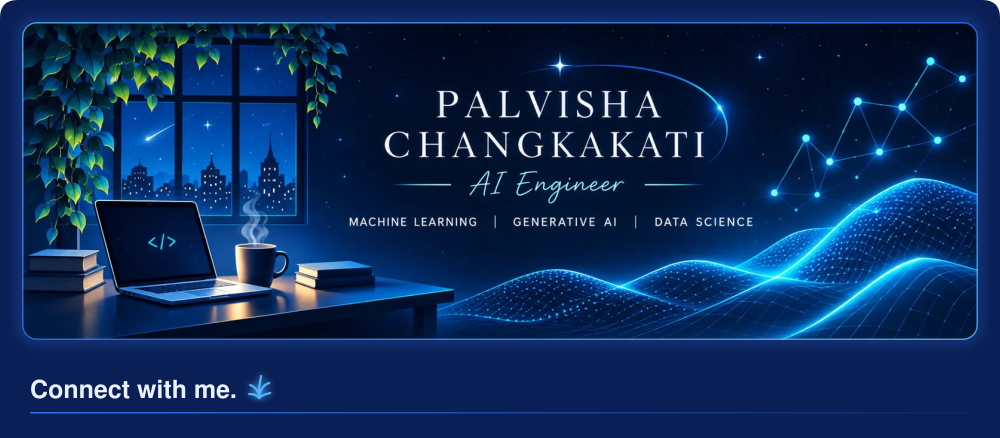

<!-- Panels in assets/panels are generated by scripts/build_profile.py (refreshed daily by .github/workflows/profile.yml). -->
<!-- Keep the image tags on these exact lines: whitespace between the button images would show as gaps. -->

