<h2>Connect with me. 🌿</h2>

  
  
  
  

---

<h2>About Me. ✦</h2>

I'm an AI Engineer with a background in Computer Science and Engineering, interested in designing and building practical AI solutions. My work and learning span machine learning, generative AI, data engineering, and intelligent applications.

- `</>` &nbsp; Building AI/ML and GenAI applications.
- `≋` &nbsp;&nbsp; Working with data, models, and real-world use cases.
- `📖` &nbsp; Exploring research-driven ideas and advanced AI methods.
- `◎` &nbsp;&nbsp; Currently preparing for a Master's in Data Science & Artificial Intelligence (Germany).

 

---

<h2>Technical Stack. ✦</h2>

  
  
  
  
  
  
  
  

---

<h2>GitHub Stats. 📊</h2>

