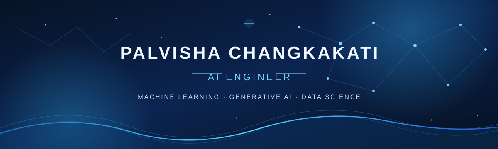

 

### AI Engineer · Machine Learning · Generative AI · Data Science

*Building intelligent systems with curiosity, clarity, and purpose.*

 

---

##  About

I'm an AI Engineer with a Bachelor's degree in Computer Science and Engineering. I enjoy working at the intersection of data, machine learning, and artificial intelligence, from preparing data and experimenting with models to building AI-powered applications.

My interests include understanding the foundations behind intelligent systems and translating that knowledge into practical, well-engineered solutions.

##  Areas of Interest

| **01 · Foundations** | **02 · Intelligence** | **03 · Applications** |
|:---:|:---:|:---:|
| Machine Learning | Generative AI | Data Science |
| Deep Learning | Large Language Models | Data Engineering |
| Statistical Learning | Retrieval-Augmented Generation | Applied AI |
|  | Natural Language Processing |  |

##  Technical Stack

**Languages**

**Machine Learning & Data**

**AI & Development**

**Data Engineering**

##  Experience

**AI Engineer**  
August 2024 – Present

Working on applied AI and data-driven engineering solutions, with experience across machine learning, generative AI, and data engineering workflows.

##  Education

**Bachelor of Engineering · Computer Science and Engineering**  
RV Institute of Technology and Management · 2024

##  Current Focus

- Strengthening foundations in machine learning and mathematical methods.
- Building reproducible, well-documented AI projects.
- Exploring research-oriented applications of data science and artificial intelligence.

---

*Curious by nature. Analytical by training. Always learning.*

Designed in midnight blue · Built with GitHub Markdown

